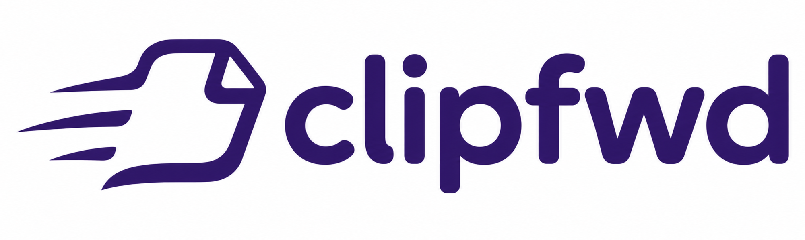
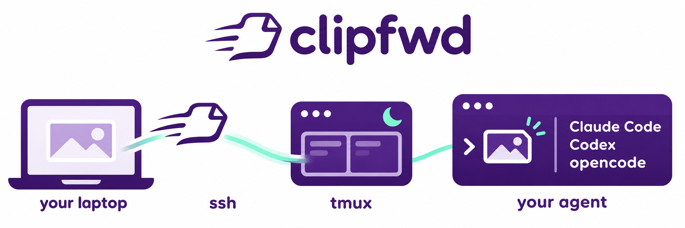

<p align="center"></p>

# clipfwd

**This project was not built. If you came here looking for a way to paste images from your local clipboard
into a CLI agent running over SSH, use [cc-clip](https://github.com/ShunmeiCho/cc-clip).**

**Setting it up?** [docs/setup-guide.md](docs/setup-guide.md) is a step by step install and review guide:
prerequisites, what gets installed where, verification, operational notes for running several servers at
once, a security review, and troubleshooting. Written for whoever runs the machines.

What follows is why, plus the research that came out of evaluating the problem. It is kept because some of it
is hard to find elsewhere.

## The problem

CLI tools that accept pasted images read the clipboard by running `xclip` or `wl-paste` on the machine they run
on. Over SSH that machine is the remote host, which has no access to your laptop's clipboard, so pressing
Ctrl+V with a screenshot does nothing.

This matters if you want to move a coding agent off your laptop. Running it on a server lets the laptop sleep,
but you lose the ability to show the agent a screenshot of what is going wrong.

## Why this repo is empty

<p align="center"></p>

This is the shape of the thing, and it is what cc-clip already does. The only argument for a second implementation was the transport underneath.


The plan was a single Go binary serving the clipboard over a Unix socket in a 0700 directory, forwarded by
`ssh -R`, with `xclip` and `wl-paste` shims on the remote. Then it turned out two tools already solve this:
[cc-clip](https://github.com/ShunmeiCho/cc-clip) (Go, MIT, mature) and
[clipaste](https://github.com/hqhq1025/clipaste) (Rust, MIT).

Both forward a loopback TCP port on the remote rather than a Unix socket. On a multi-user remote, any local
user can reach that port, and cc-clip's [SECURITY.md](https://github.com/ShunmeiCho/cc-clip/blob/main/SECURITY.md)
says so plainly: "loopback is reachable by other local users on that machine. The token is the access control
boundary." A Unix socket inside a 0700 directory removes the port and the token, because filesystem
permissions become the authentication.

That was the case for building this. It did not survive contact with the practical question: on a single-user
VM, which is what cc-clip recommends and what most people actually have, the difference is close to
theoretical. cc-clip was tested and it works, losslessly, with no phone-home behaviour.

## Still an open contribution, if anyone wants it

cc-clip cannot simply switch to a Unix socket. Its TCP choice is load-bearing for Codex support: Codex reads
the X11 clipboard in-process inside a sandbox that cannot reach `/tmp/.X11-unix/`, so cc-clip runs a virtual
display and reaches it over TCP loopback. A Unix socket transport offered *alongside* the TCP one, used for
agents that shell out to `xclip`, would give shared-host users a better security story without breaking Codex.

## The useful part: Claude Code's clipboard contract

Read out of the unstripped Claude Code 2.1.326 binary on Linux. This is what it actually runs, so it is what
any shim has to satisfy.

Detection. Its exit code gates everything that follows:

```sh
xclip -selection clipboard -t TARGETS -o 2>/dev/null | grep -E "image/(png|jpeg|jpg|gif|webp|bmp)" \
  || wl-paste -l 2>/dev/null | grep -E "image/(png|jpeg|jpg|gif|webp|bmp)"
```

Fetch. Four fallbacks, in this order:

```sh
xclip -selection clipboard -t image/png -o > FILE 2>/dev/null \
  || wl-paste --type image/png     > FILE 2>/dev/null \
  || xclip -selection clipboard -t image/bmp -o > FILE 2>/dev/null \
  || wl-paste --type image/bmp     > FILE
```

Things worth knowing about it:

- **The image read path does not check `DISPLAY` or `WAYLAND_DISPLAY`.** The display probing in Claude Code
  belongs to the text *copy* path, which uses it to choose between `wl-copy`, `xclip`, `xsel` and an addon.
  So a shim does not need a display variable to exist, and inventing a fake one is actively harmful: a
  `DISPLAY` with no X server behind it breaks clipboard fallback for every other tool in that shell.
- **OSC 52 is not involved in image reads.** All the OSC 52 handling is in the outbound copy path. Worth
  re-checking per release, but as of 2.1.326 a `PATH` shim is the right layer.
- **`TARGETS` may advertise any of png, jpeg, jpg, gif, webp or bmp.** Serving `image/png` alone satisfies the
  grep.
- **Claude Code converts BMP to PNG itself**, sniffing for the `0x42 0x4D` magic. A shim can safely fail on
  `image/bmp` as long as `image/png` succeeds.
- **`text/plain` is not inert.** A separate code path reads `text/plain` and treats the result as a *file path*,
  matching it against `\.(png|jpe?g|gif|webp)$`. Any text clipboard support interacts with image pasting.
- Tools differ. Codex CLI and Grok Build read X11 in-process and never call the shim at all. Cursor requires a
  display variable to be set in its own shell.

A useful consequence: running those two command strings by hand on the remote is a complete functional test of
any shim. It needs neither the agent nor a human keypress, because it is exactly what the agent executes.

## Other findings

- `RemoteForward` socket paths accept `%`-tokens from OpenSSH 8.3 and `${ENV}` from 8.4, but there is no token
  for the *remote* home directory: `%d` and `${HOME}` both expand on the client. `%r` (remote username) is the
  only remote-aware handle, so the remote path has to be resolved at install time on the remote host.
- sshd performs no expansion at all on the remote listen path. It binds the literal string
  (`channel_setup_fwd_listener_streamlocal()` passes it straight to `unix_listener()`). A 2017 patch proposing
  relative path expansion was never merged.
- `StreamLocalBindMask` (default `0177`, so mode 0600) and `StreamLocalBindUnlink` are honored, but
  `sshd_config(5)` warns that "not all operating systems honor the file mode on Unix-domain socket files". A
  0700 parent directory is the only portable protection.
- A predictable socket path in `/tmp` can be pre-created by another local user. `/tmp` is sticky, so sshd
  cannot unlink a foreign file: the forward fails and the shim then talks to the squatter. For a tool feeding
  an AI agent, that is a content injection channel, which is worse than a leak.
- **ssh config forwards accumulate, they do not override.** A `Host *` block and a per-host block that both
  match will produce two `RemoteForward` lines, and the second fails. `Host * !vm1 !vm2` works. Verified with
  `ssh -G` on OpenSSH 10.5.
- `Host *` is risky here beyond that: a scripted `scp`, `git` or `rsync` to an enrolled host also carries the
  forward, takes the socket from the interactive session, and with `StreamLocalBindUnlink yes` deletes it on
  exit.
- macOS synthesizes many clipboard flavors from one PNG (measured: PNGf 37084, TIFF 51350, BMP 48054, JPEG
  11153, AVIF 7420, and more). Reading `«class PNGf»` returned the input bytes unchanged.

## License

The code that does not exist would have been [AGPL-3.0](LICENSE). The notes above are offered freely; if you
want to reuse them under something more permissive, open an issue and ask.
